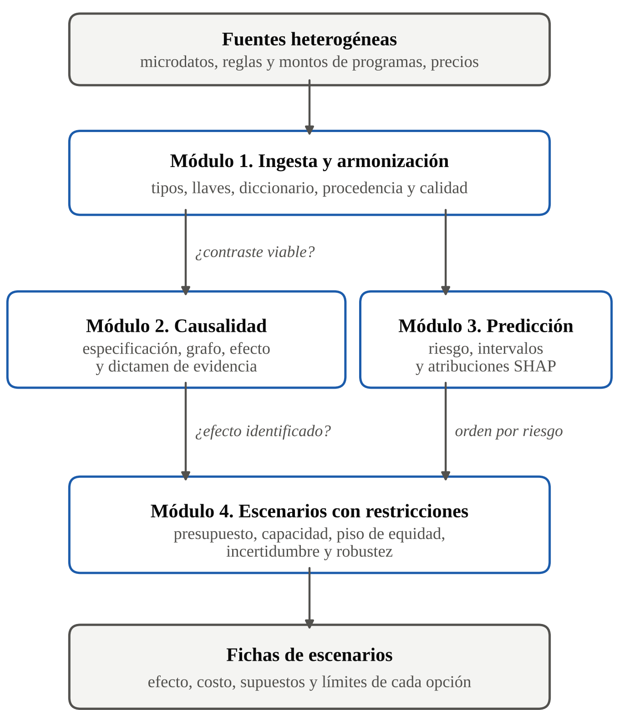
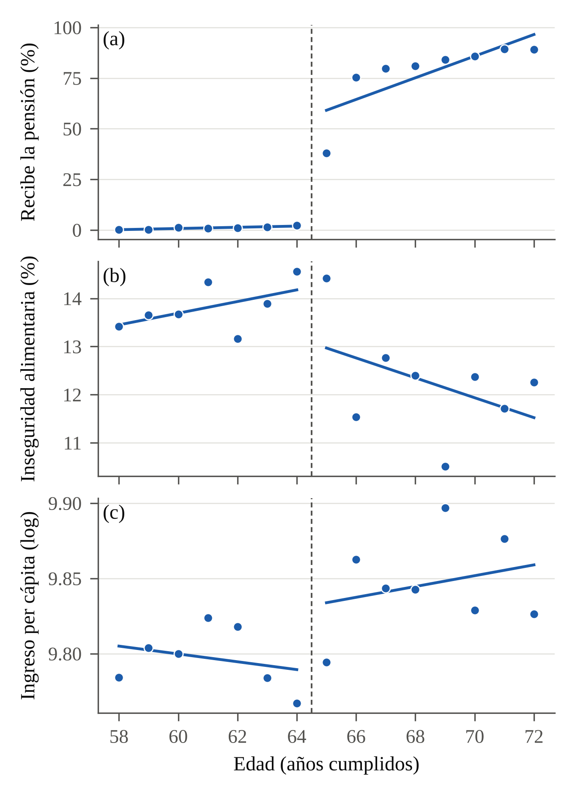

# Framework automatizado para descubrimiento causal y optimización de políticas públicas


Este repositorio contiene el código, las pruebas, los datos procesados y los resultados de la tesina *Framework Automatizado para Descubrimiento Causal y Optimización de Políticas Públicas*, de Emiliano De Luna Aguilar (Universidad Anáhuac Cancún, 2026).

El framework lleva microdatos públicos hasta escenarios de política comparables en cuatro pasos:
1. Integra y armoniza las fuentes.
2. Busca y estima efectos causales sólo donde un diseño de identificación los sostiene.
3. Predice qué hogares están en riesgo.
4. Compara opciones de asignación con el presupuesto, la capacidad y la equidad como restricciones duras.

Se evaluó en Quintana Roo con la Encuesta Nacional de Ingresos y Gastos de los Hogares (ENIGH) 2016–2024 del INEGI. Cada cifra de la tesis sale de un script de este repositorio, y un solo comando las reproduce todas.

**Contenido:** [Por qué se hizo](#por-qué-se-hizo) · [Cómo funciona](#cómo-funciona) · [Qué encontró](#qué-encontró) · [Instalación](#instalación) · [Uso](#uso) · [Resultados esperados](#resultados-esperados) · [Estructura](#estructura-del-repositorio) · [De la tesis al código](#de-la-tesis-al-código) · [Datos](#datos) · [Límites](#límites) · [Licencia y cita](#licencia)

## Por qué se hizo

Los gobiernos generan muchos datos, pero los usan sobre todo para describir. Un informe típico compara a quienes reciben un programa con quienes no lo reciben. Esa comparación mezcla el efecto del programa con las razones por las que unos lo reciben y otros no.

En este caso, la comparación invierte el signo. En el país, las personas de 65 a 75 años que reciben la pensión de adultos mayores viven en hogares con 1.8% menos ingreso per cápita que quienes no la reciben, porque el programa llega a hogares más pobres; en Quintana Roo la diferencia llega a −12.9%. El efecto causal, estimado con una regresión discontinua en la edad de elegibilidad, es un aumento de 9.8%.

Las herramientas para ir más allá ya existen: descubrimiento causal, diseños de identificación, aprendizaje automático y optimización. Suelen usarse por separado y sin una regla común para decidir cuándo un resultado sostiene una recomendación. Este proyecto las integra en un flujo reproducible con tres reglas:

1. Una predicción nunca se presenta como efecto causal.
2. Un efecto se reporta sólo si es identificable. Si no lo es, el framework lo dice con un dictamen explícito: identificado, identificado frágil, no distinguible de cero, sin efecto estructural, asociación mecánica o inviable.
3. Los criterios de decisión de cada prueba (umbrales, márgenes y reglas de elección) se fijan antes de estimarla. Lo no previsto se reporta como exploratorio.

La conclusión central de la tesis es que el framework vale menos por los efectos que encuentra que por las conclusiones equivocadas que impide. Dictaminó inviable el contraste planeado al inicio, evitó una comparación que invertía el signo del efecto de la pensión y mostró que la mejor asignación de un programa depende de la restricción que lo limita.

## Cómo funciona

<p align="center"></p>

Cada módulo expone entradas, salidas y diagnósticos verificables. La identificación causal y el soporte en los datos funcionan como condiciones de paso. Si un efecto no es identificable o una acción no tiene soporte, el flujo se detiene y lo informa en vez de producir una recomendación.

| Módulo | Qué hace | Produce | Código |
| --- | --- | --- | --- |
| 1. Ingesta y armonización | Integra cinco levantamientos de la ENIGH (personas, hogares, ingresos y trabajos). Detecta el tipo de cada variable, armoniza las claves de programa y de municipio que cambian entre años, deflacta con el INPC, vincula la categoría indígena de los municipios y concilia la inseguridad alimentaria con CONEVAL | Bases integradas, diccionario de datos, matriz de procedencia y reporte de calidad | `ingesta/` |
| 2. Descubrimiento y estimación causal | Registra el papel y el orden temporal de cada variable. Descubre la estructura con PC, FCI, GES y LiNGAM con remuestreo e identifica el conjunto de ajuste óptimo. Estima con ajuste lineal, AIPW con ajuste cruzado o regresión discontinua, y somete cada efecto a refutaciones y a un análisis de sensibilidad | Grafo candidato, efecto con IC95 sólo si es identificable, y dictamen | `modulo_causal/` |
| 3. Predicción explicable | Compara regresión logística regularizada y árboles de gradiente acotados con origen móvil: entrena hasta un levantamiento y predice el siguiente. Calcula intervalos conformales y atribuciones SHAP | Modelos, métricas fuera de muestra, intervalos y atribuciones | `experimentos/*_m3.py` |
| 4. Comparación de escenarios | Combina reglas de prioridad con montos bajo presupuesto, capacidad y un piso de equidad. Propaga la incertidumbre de los efectos y de la población, y prueba tres curvas monto-efecto. PPO se evalúa aparte, en un entorno sintético | Opciones factibles con impacto esperado, IC95, costo, probabilidad de ser la mejor y supuestos | `modulo_escenarios/`, `experimentos/*_m4.py` |

Más detalle sobre el módulo 2:
- Una prueba dirigida de efecto total contrasta la independencia entre intervención y resultado dados los padres de la intervención. Así recupera la arista que la cancelación entre efecto y confusión puede borrar del grafo.
- La sensibilidad se mide con el valor de robustez: la fuerza mínima que tendría que tener un confusor no medido para anular el efecto.

Más detalle sobre los módulos 3 y 4:
- El módulo predictivo compara tres conjuntos de variables: los padres candidatos del resultado en el grafo (C), todas las variables previas (T) y T más el gasto concurrente (G), que sirve de cota porque el gasto no se conoce al focalizar.
- En el comparador, una opción es robusta si logra al menos 90% de la mejor opción factible en todas las combinaciones de modelo de efecto y curva.

## Qué encontró

Caso de estudio: programas sociales en Quintana Roo, con la ENIGH 2016–2024 (1,461,036 personas en el país; 35,639 en el estado).

1. **Un contraste inviable, detectado a tiempo (Tabla II).** El contraste planeado era el gasto del PAE frente a la desocupación trimestral. En simulaciones con estructura conocida, con 36 trimestres la potencia fue de 52% y PC no recuperó la arista en ninguna réplica. Se dictaminó inviable antes de recopilar las series.
2. **Verdad conocida (Tabla III).** En el experimento NSW se reemplazaron los controles experimentales por controles observacionales. El framework estimó un efecto de 1.78 miles de dólares, frente a 1.79 del experimento, y lo calificó de "identificado frágil".
3. **Pensión de adultos mayores (Tabla IV y Fig. 2).** Una regresión discontinua difusa a los 65 años, con la muestra nacional, muestra que la pensión eleva 9.8% el ingreso per cápita del hogar (IC95 +4.5% a +15.0%). Su efecto sobre la inseguridad alimentaria (−1.8 puntos porcentuales; IC95 −3.9 a +0.3) no se distingue de cero en la especificación principal, pero sí en mujeres (−2.9 pp), en quienes no tienen pensión contributiva (−2.8 pp) y sin la edad del umbral (−3.2 pp).
4. **El análisis tradicional se equivoca de signo (Tabla VI).** Comparar a quienes reciben la pensión con quienes no la reciben (65 a 75 años) da 1.8% menos ingreso en el país y 12.9% menos en Quintana Roo, frente al +9.8% del efecto causal (58 a 72 años). La muestra estatal no basta para estimar el efecto: su estimación de ingreso va de −37% a +43%, y el efecto mínimo detectable sobre la inseguridad alimentaria es de unos 22 pp.
5. **Predicción (Tabla VII).** Para focalizar, todas las variables previas (T) predicen mejor que los padres candidatos del grafo (C): AUC de 0.758 frente a 0.741, y 0.601 de la persistencia. El framework usa T para focalizar y C para explicar.
6. **Pensión Mujeres Bienestar (Tablas IX, X y XIV).** La mejor asignación depende de la restricción:
   - con el presupuesto de referencia (590 millones de pesos al año, el costo proyectado de la opción vigente) y bajo los supuestos evaluados, la opción vigente queda a no más de 1% del mejor resultado modelado;
   - con 70% de ese presupuesto, conviene bajar el monto y cubrir a más mujeres;
   - si sólo puede registrarse a la mitad de las elegibles, el monto vigente deja sin ejercer 44% del presupuesto. Subir el monto conviene sólo si ese dinero no tiene un mejor uso y si el efecto crece con el monto.
7. **Prueba con una reforma real (Tabla XIII).** En 2021 la edad de la pensión bajó de 68 a 65 años. Con sólo datos de 2020, el efecto predicho de ese cambio fue consistente con el observado en 2022 y 2024, aunque la prueba no fue informativa. La incorporación se subestimó en 18 pp.
8. **Aprendizaje por refuerzo (Tabla XI).** En un entorno sintético, PPO logró 92% del óptimo de su clase cuando el efecto es constante, pero perdió hasta 54% fuera del mundo en que se entrenó. Por eso queda como extensión experimental.

En siete de ocho contrastes el dictamen fue más restrictivo que "efecto identificado, distinto de cero y robusto" (Tabla XII).

<p align="center"></p>

## Instalación

Requiere Python 3.13.

```bash
git clone https://github.com/0x141310/framework-causal-politicas-publicas.git
cd framework-causal-politicas-publicas
python -m venv .venv
source .venv/bin/activate          # en Windows: .venv\Scripts\activate
pip install -r requirements.txt
pip install --no-deps -r requirements-sin-dependencias.txt
```

- Los paquetes del segundo archivo (lingam, semopy, pygam y psy) se instalan sin sus dependencias declaradas, como en el entorno donde se corrió la tesis; las que usa el código ya están en el primero.
- torch sólo se usa en PPO. En Linux sin GPU puedes instalar antes la versión para CPU, que es mucho más ligera: `pip install torch==2.15.0 --index-url https://download.pytorch.org/whl/cpu`.
- Los scripts `.sh` requieren bash (Linux, macOS o WSL en Windows); `descargar_enigh.sh` usa además `curl` y `unzip`.

## Uso

### Pruebas rápidas

```bash
python -m pytest -q pruebas
```

Las 24 pruebas corren en segundos y verifican cinco cosas:
- PC y LiNGAM recuperan la arista intervención → resultado en un modelo simulado con capas temporales;
- el estimador de regresión discontinua recupera un efecto conocido en datos simulados;
- el comparador respeta el presupuesto, la capacidad y los empates, también al calcular la probabilidad de que una opción sea la mejor;
- el verificador de la reproducción termina con error si un archivo difiere o falta;
- los datos incluidos reproducen la integración (1,461,036 personas, sin duplicados), la conciliación con CONEVAL (19.95% en 2016 y 20.29% en 2018) y la lectura del anexo de 2020 (623 municipios de categoría indígena A o B).

### Reproducir toda la tesis

Con los datos procesados que incluye el repositorio:

```bash
bash ejecutar_todo.sh
```

Desde los microdatos públicos del INEGI, rehaciendo antes la ingesta:

```bash
bash descargar_enigh.sh microdatos       # unos 1.1 GB descomprimidos
bash ejecutar_todo.sh microdatos
```

El script corre las pruebas y cada análisis en el orden de la tesis, guarda lo que imprime cada uno en `resultados/<nombre>.log` y, al final, compara lo producido con la versión publicada (ver [Resultados esperados](#resultados-esperados)). Cada ejecución empieza con `resultados/` vacía (la anterior pasa a `resultados_anterior/`) y, si rehace la ingesta, también con `datos/` vacía (la anterior pasa a `datos_anterior/`). Así, un archivo que no se genere aparece como faltante en lugar de pasar por idéntico. El script termina con un código distinto de cero si falla una prueba o un análisis, o si algún archivo difiere o falta.

Tiempos aproximados con 2 núcleos:
- el descubrimiento del módulo predictivo tarda unos 40 minutos, PPO unos 13 y la predicción unos 5;
- los demás análisis, de segundos a 2 minutos;
- la corrida completa, unos 80 minutos.

### Correr un solo análisis

Desde la raíz del repositorio:

```bash
PYTHONHASHSEED=0 python experimentos/escenarios_m4.py
```

`shap_m3.py` y `descomposicion_m3.py` usan los modelos que guarda `prediccion_m3.py` en `resultados/modelos_m3_*.joblib`. Esos archivos no se incluyen, porque son objetos de Python serializados; se regeneran al correr `prediccion_m3.py`.

### Usar los módulos con otros datos

Los tres ejemplos siguientes se corren en Python desde la raíz del repositorio.

**Descubrimiento, estimación y dictamen.** Se declara el papel y la capa temporal de cada variable, y el módulo hace el resto:

```python
import numpy as np, pandas as pd
from modulo_causal import CausalSpec, Variable, pipeline

rng = np.random.default_rng(0)
n = 4000
z = rng.normal(size=n)                          # covariable previa que confunde
x = (z + rng.normal(size=n) > 0).astype(int)    # intervención binaria
y = 0.5 * x + 0.8 * z + rng.normal(size=n)      # resultado; efecto verdadero: 0.5
df = pd.DataFrame({"z": z, "x": x, "y": y})

spec = CausalSpec(
    [Variable("z", "previa", 0),
     Variable("x", "intervencion", 1, "binaria"),
     Variable("y", "resultado", 2)],
    treatment="x", outcome="y")
R = pipeline.run_module(df, spec, B=20, seed=1, flexible=False)
print(pipeline.print_report(R, spec))
```

Tarda unos segundos. El reporte muestra el grafo recuperado (`z --> x`, `z --> y`, `x --> y`), el ajuste por `z` y dos estimaciones cercanas a 0.5: 0.5205 por ajuste lineal y 0.5135 por AIPW. Termina con el dictamen `efecto_identificado_bajo_supuestos`. FCI advierte que no puede descartar un confusor latente, y el valor de robustez indica qué tan fuerte tendría que ser para anular el efecto. Con `flexible=True`, AIPW usa árboles de gradiente: es más flexible, pero tarda minutos.

**Regresión discontinua con la ENIGH incluida.** Este ejemplo reproduce el efecto de la pensión sobre el ingreso de la Tabla IV:

```python
import numpy as np, pandas as pd
from modulo_causal import rdd

df = pd.read_parquet("datos/enigh_personas_2022_2024.parquet")
df["hogar_id"] = df["anio"].astype(str) + "_" + df["folioviv"] + "_" + df["foliohog"].astype(str)
r = rdd.estimate(df, running="edad", cutoff=65, outcome="log_ing_pc", treat="pam",
                 bw=7, cluster="hogar_id")
ic95 = np.expm1(r["el_ic95"]).round(3).tolist()          # de logaritmo a cambio porcentual
print(r["n"], round(r["primera_etapa"], 3), round(r["efecto_local"], 4), ic95)
```

Imprime `71243 0.497 0.0938 [0.045, 0.15]`: 71,243 personas de 58 a 72 años, un salto de 50 pp en la recepción de la pensión y un efecto de +9.8% en el ingreso (IC95 +4.5% a +15.0%). El intervalo sale de 999 réplicas bootstrap por hogar con semilla fija.

**Comparar opciones de asignación.** Cada opción es una regla de prioridad más un monto bimestral. El comparador asigna hasta agotar el presupuesto o la capacidad y propaga la incertidumbre:

```python
import numpy as np
from modulo_escenarios.comparador import Option, evaluate, summarize, prob_best

rng = np.random.default_rng(0)
N, B = 1000, 200                                    # personas en la muestra y réplicas
w = rng.uniform(20, 60, N)                          # personas que representa cada una
w_rep = w * rng.gamma(50, 1 / 50, (B, N))           # réplicas de la población
riesgo = rng.uniform(size=N)
en_ia = (rng.uniform(size=N) < 0.25 + 0.3 * riesgo).astype(float)
efecto = {"ia_mod_sev": -0.02 - 0.04 * riesgo,      # efecto por beneficiaria con 6,000 pesos
          "ia_adultos": np.full(N, -0.15), "log_ing_pc": np.full(N, 0.10)}
efecto_rep = {k: v + rng.normal(0, 0.01, (B, N)) for k, v in efecto.items()}
comun = dict(w=w, w_draws=w_rep, tau=0.9, budget=150e6, capacity=np.inf, admin=0.0,
             theta_pt=efecto, theta_dr=efecto_rep, curve="D2", attrs={"en_ia": en_ia})

opciones = [Option("todas", 3000, np.zeros(N), np.ones(N, bool)),
            Option("riesgo", 3000, riesgo, np.ones(N, bool)),
            Option("riesgo", 6000, riesgo, np.ones(N, bool))]
res = [evaluate(o, **comun) for o in opciones]
for o, r, p in zip(opciones, res, prob_best(res, [True] * len(res))):
    s = summarize(r)
    print(o.regla, o.monto, round(s["punto"]["beneficiarias"]),
          round(s["punto"]["hogares_salen_ia"]), f"P(mejor) {p:.0%}")
```

Con 150 millones de pesos al año caben 8,333 beneficiarias con 3,000 pesos. Priorizar por riesgo saca de la inseguridad alimentaria a 327 hogares, frente a 235 sin prioridad; con 6,000 pesos caben la mitad y salen 240. Los argumentos están documentados en `modulo_escenarios/comparador.py`, y `experimentos/escenarios_m4.py` aplica el comparador completo a la Pensión Mujeres Bienestar.

## Resultados esperados

**Pruebas.** `python -m pytest -q pruebas` termina con `24 passed`.

**Corrida completa.** `ejecutar_todo.sh` imprime `== <nombre>` antes de cada análisis, seguido de su salida. Cada script escribe sus resultados en `resultados/` (JSON, CSV y parquet) y su registro en `resultados/<nombre>.log`.

**Comparación final.** La primera ejecución guarda una copia de `datos/` y `resultados/` en `publicado/`. Al terminar, `comparar_resultados.py` compara cada JSON, CSV y parquet con esa copia:
- los números, con tolerancia relativa de 1e-6;
- los textos, sin tolerancia;
- los registros y los tiempos de ejecución no se comparan;
- un archivo que no se generó cuenta como faltante.

`comparar_resultados.py` termina con código 0 si todo coincide y con código 1 si algún archivo difiere o falta; `ejecutar_todo.sh` devuelve ese mismo resultado.

Los datos y resultados de este repositorio salen de una corrida completa de `bash ejecutar_todo.sh microdatos` en Linux con 2 núcleos, Python 3.13 y las versiones de `requirements.txt`. Con esas versiones, una reproducción debe terminar así (se omiten líneas):

```text
== datos frente a publicado/datos
  idéntico  calidad_ingesta_2016_2024.json
  …
   idénticos: 12; dentro de la tolerancia: 0; distintos: 0; faltantes: 0 (no se comparan registros ni tiempos)
== resultados frente a publicado/resultados
  idéntico  beca_universal_did.json
  …
  coincide  ppo_m4.json  (mismos valores)
  …
   idénticos: 25; dentro de la tolerancia: 1; distintos: 0; faltantes: 0 (no se comparan registros ni tiempos)
listo: todos los archivos coinciden con la versión publicada.
```

`ppo_m4.json` sale como «coincide» y no como «idéntico» porque guarda el tiempo de cada entrenamiento. Con otras versiones de las bibliotecas pueden variar decimales de PPO y de los modelos de boosting. Si borras `publicado/`, la siguiente ejecución toma como referencia lo que haya en ese momento en `resultados/`.

**Cifras para revisar a mano:**

| Tabla de la tesis | Cifra | Dónde está |
| --- | --- | --- |
| III, NSW | Efecto de 1.78 miles de dólares | `resultados/nsw_pipeline.log`, primera línea `AIPW-ATT` |
| IV, pensión en el país | 0.0938 en logaritmo, es decir +9.8% de ingreso | `resultados/piloto_b_pension.json` → `nacional.log_ing_pc.efecto_local` |
| VII, predicción | AUC de 0.758 (T) y 0.741 (C) | `resultados/prediccion_m3.json` → `promedio_origenes.pais.T.punto.auc` |
| IX, Pensión Mujeres Bienestar | 472 hogares salen de la inseguridad alimentaria | `resultados/escenario_pmb.json` → `escenario.A_universal.hogares_salen_ia.esperado` |
| XIII, reforma de 2021 | Incorporación predicha de 69.6% frente a 88.0% observada | `resultados/reforma_2021_exante.json` → `incorporacion` |
| XIV, regla vigente en K | 0.56 del impacto alcanzable en el peor caso y 0.78 en promedio | `resultados/utilidad_m4.json` → `condiciones.K.vigente` |

Por ejemplo:

```bash
python -c "import json; print(json.load(open('resultados/piloto_b_pension.json'))['nacional']['log_ing_pc']['efecto_local'])"
```

**Integridad de la descarga.** `sha256sum -c MANIFEST.sha256` (en macOS, `shasum -a 256 -c MANIFEST.sha256`) verifica que los archivos descargados son los de esta versión. Sirve antes de correr nada: después de una ejecución, los registros y los tiempos cambian aunque las cifras sean iguales.

## Estructura del repositorio

```text
├── ingesta/                  módulo 1: integración de la ENIGH, diccionario y procedencia
├── modulo_causal/            módulo 2: especificación, descubrimiento, identificación, estimación,
│                             refutación y regresión discontinua
├── modulo_escenarios/        módulo 4: comparador con presupuesto, capacidad, equidad e incertidumbre
├── experimentos/             un script por análisis de la tesis
├── pruebas/                  pruebas automáticas (pytest)
├── fuentes/                  anexo A de las zonas de atención prioritaria 2020 y catálogo de localidades
│                             indígenas 2010 (CDI, hoy INPI), sin cambios
├── datos/                    ENIGH integrada (parquet), municipios indígenas, diccionario y procedencia
├── resultados/               salidas de cada script y sus registros
├── figuras/                  figuras 1 y 2 de la tesis y el script que las genera
├── ejecutar_todo.sh          pruebas y todos los análisis en orden, con comparación final
├── comparar_resultados.py    compara dos carpetas de resultados con tolerancia numérica
├── descargar_enigh.sh        descarga del INEGI los microdatos originales
├── requirements*.txt         versiones exactas de las bibliotecas
├── CITATION.cff              datos para citar el repositorio
├── LICENSE, LICENSE-CC-BY-4.0.md
└── MANIFEST.sha256           hash SHA-256 de cada archivo de esta versión
```

En `ingesta/`, los scripts `chequeos.py`, `claves_por_anio.py`, `explorar.py`, `montos.py` y `primeras_etapas.py` son verificaciones exploratorias de claves de programa, montos y primeras etapas.

## De la tesis al código

| Tabla o figura de la tesis | Script | Resultado |
| --- | --- | --- |
| Fig. 1, arquitectura | `figuras/figuras.py` | `figuras/fig_arquitectura.png` |
| Tabla I, integración de la ENIGH | `ingesta/enigh.py`, `ingesta/hogares_m3.py` | `datos/*calidad*.json` |
| Tabla II, pruebas con series y microdatos simulados | `experimentos/sim_temporal.py`, `experimentos/sim_social.py` | `resultados/sim_*` |
| Tabla III, experimento NSW | `experimentos/benchmark_nsw.py`, `nsw_pipeline.py`, `nsw_semillas.py` | `resultados/nsw_*` |
| Tabla IV y Fig. 2, pensión a los 65 años | `experimentos/piloto_b_pension.py`, `figuras/figuras.py` | `resultados/piloto_b_pension.json`, `figuras/fig_discontinuidad.png` |
| Municipios indígenas de la regla de 2020 | `ingesta/zap2020.py`, `ingesta/inpi.py` | `datos/categoria_indigena_2020.csv`, `datos/inpi_municipios_2010.csv` |
| Falsación con el cambio de regla | `experimentos/falsacion_regla.py`, `falsacion_ventanas.py` | `resultados/falsacion_*.json` |
| Pensión medida sólo con la clave P104 | `experimentos/robustez_p104.py` | `resultados/robustez_p104.json` |
| Tablas V, VI y IX: heterogeneidad, análisis tradicional y escenario de la Pensión Mujeres Bienestar | `experimentos/escenario_pmb.py` | `resultados/escenario_pmb.json` |
| Becas Benito Juárez | `experimentos/piloto_a_becas.py`, `beca_universal_did.py` | `resultados/piloto_a_becas.json`, `beca_universal_did.json` |
| Tabla VII, predicción con origen móvil | `experimentos/descubrimiento_m3.py`, `prediccion_m3.py` | `resultados/descubrimiento_m3.json`, `prediccion_m3.json`, `predicciones_m3.parquet` |
| Atribuciones SHAP | `experimentos/shap_m3.py` | `resultados/shap_m3.json` |
| Tabla VIII, efecto por tercil de riesgo predicho | `experimentos/riesgo_pension_m3.py` | `resultados/riesgo_pension_m3.json` |
| Tabla X, comparador con restricciones | `experimentos/escenarios_m4.py` | `resultados/escenarios_m4.json` |
| Tabla XI, PPO en entorno sintético | `experimentos/ppo_m4.py` | `resultados/ppo_m4.json` |
| Tabla XIII, reforma de 2021 | `experimentos/reforma_2021_exante.py` | `resultados/reforma_2021_exante.json` |
| Tabla XIV, pérdida de la regla vigente | `experimentos/utilidad_m4.py` | `resultados/utilidad_m4.json` |
| Tablas XVII a XX y conciliación con CONEVAL | `ingesta/diccionario.py` | `datos/diccionario_datos.csv`, `datos/matriz_procedencia.csv`, `resultados/oe1_ingesta.json` |

Las tablas XII, XV y XVI resumen resultados de las anteriores. `experimentos/descomposicion_m3.py` es un análisis exploratorio que la tesis no reporta en tablas.

## Datos

- **Fuente:** INEGI, ENIGH 2016, 2018, 2020, 2022 y 2024, nueva serie, microdatos públicos.
- **Uso:** sujeto a los Términos de Libre Uso de la Información del INEGI. Cita la fuente.
- **Municipios indígenas:** las reglas de operación de 2020 hacían elegible a los 65 años a quien vivía en un municipio o localidad indígena de tipo A o B. Como la ENIGH pública no identifica la localidad, la regla se asigna por municipio:
  - **Principal:** categoría indígena de 2020, del anexo A del *Decreto por el que se formula la Declaratoria de las Zonas de Atención Prioritaria para el año 2020* (Diario Oficial de la Federación, 11 de diciembre de 2019). `ingesta/zap2020.py` lee el PDF del anexo (1,480 municipios; 623 de categoría A o B). El PDF es la copia que difunde la Secretaría de Finanzas del Gobierno de Tlaxcala.
  - **Sensibilidades:** el *Catálogo de localidades indígenas 2010* de la Comisión Nacional para el Desarrollo de los Pueblos Indígenas (CDI, hoy INPI), con 624 municipios de 40% o más de población indígena (`ingesta/inpi.py`; https://www.inpi.gob.mx/localidades2010-gobmx/), y la aproximación con los hablantes de lengua indígena de la propia ENIGH.
  - Ambos archivos se incluyen sin cambios en `fuentes/` para que la ejecución no dependa de una descarga.
- **Experimento NSW:** usa los datos del paquete `causaldata`.
- **Parámetros externos:** el INPC, los montos de los programas y las cifras de CONEVAL están en el código con su fuente; la tesis los documenta en el Anexo A.

| Archivo de `datos/` | Contenido |
| --- | --- |
| `enigh_personas_2022_2024.parquet` | Personas del país en 2022 y 2024 (análisis causal) |
| `enigh_personas_2016_2024.parquet` | Personas del país de 2016 a 2024 |
| `enigh_hogares_2016_2024.parquet` | Hogares del país de 2016 a 2024 (módulo predictivo) |
| `enigh_qroo_personas_*.parquet` | Subconjuntos de Quintana Roo |
| `categoria_indigena_2020.csv` | Categoría indígena de 2020 de cada municipio del anexo A, con la clave de cinco dígitos de la ENIGH |
| `inpi_municipios_2010.csv` | Tipo de cada municipio en el catálogo del INPI, con la clave de cinco dígitos de la ENIGH |
| `diccionario_datos.csv`, `matriz_procedencia.csv` | Diccionario de 120 variables y origen de cada variable por año |
| `*calidad*.json` | Reportes de calidad de la ingesta |

Todas son salidas de `ingesta/`. `bash ejecutar_todo.sh microdatos` las regenera desde los archivos del INEGI y los de `fuentes/`.

## Límites

- **Confusión no medida.** Es el punto ciego del descubrimiento. En las simulaciones con confusión latente, el módulo concluyó efectos falsos y FCI casi nunca alertó. Por eso las afirmaciones con datos reales descansan en un diseño de identificación, la regresión discontinua.
- **Muestra estatal.** La de Quintana Roo no basta para estimar efectos en el estado; se usa el efecto nacional bajo un supuesto de transporte declarado.
- **Regla de 2020.** La falsación y la prueba con la reforma de 2021 asignan la elegibilidad de 2020 por municipio, porque la ENIGH pública no identifica las localidades indígenas ni el padrón de quienes ya recibían la pensión de 65 a 67 años.
- **Escenarios.** Sus magnitudes dependen de la curva monto-efecto, que hoy no puede estimarse con precisión, y de la tasa de incorporación, que en la prueba con la reforma de 2021 falló por 18 pp. El orden de las opciones es robusto a los supuestos; la magnitud, no.
- **Predicción.** Sólo hay dos orígenes de prueba. Los modelos sobrestimaron la prevalencia nacional entre 1.5 y 2.7 pp y discriminan peor en hogares rurales e indígenas.
- **PPO.** Se probó sólo en un entorno sintético; no recomienda políticas.
- **Utilidad.** No se midió la utilidad percibida por quienes deciden.

## Licencia

- **Código:** licencia MIT (`LICENSE`).
- **Textos, figuras y resultados:** licencia CC BY 4.0 (`LICENSE-CC-BY-4.0.md`).
- **Datos de `datos/`:** derivan de la ENIGH y siguen los Términos de Libre Uso de la Información del INEGI; `categoria_indigena_2020.csv` y `inpi_municipios_2010.csv` derivan de los documentos públicos de `fuentes/` (el decreto del DOF y el catálogo de la CDI, hoy INPI), que se citan como fuente.

## Cómo citar

De Luna Aguilar, E. (2026). *Framework automatizado para descubrimiento causal y optimización de políticas públicas: código, pruebas y resultados* (versión 1.0) [Software]. Universidad Anáhuac Cancún. https://github.com/0x141310/framework-causal-politicas-publicas

GitHub muestra la cita en formato APA y BibTeX a partir de `CITATION.cff`.

## English summary

Code, tests, processed data and results of the thesis *Framework Automatizado para Descubrimiento Causal y Optimización de Políticas Públicas* (an automated framework for causal discovery and public policy optimization; Universidad Anáhuac Cancún, 2026). The framework chains four modules:
- data integration;
- causal discovery and estimation, which reports an effect only when it is identifiable;
- explainable prediction;
- scenario comparison under budget, capacity and equity constraints.

It was evaluated on social programs in Quintana Roo, Mexico, with the ENIGH household survey (2016–2024). Each figure in the thesis comes from a script in this repository, and `bash ejecutar_todo.sh` reproduces all of them and compares them with the published results.
